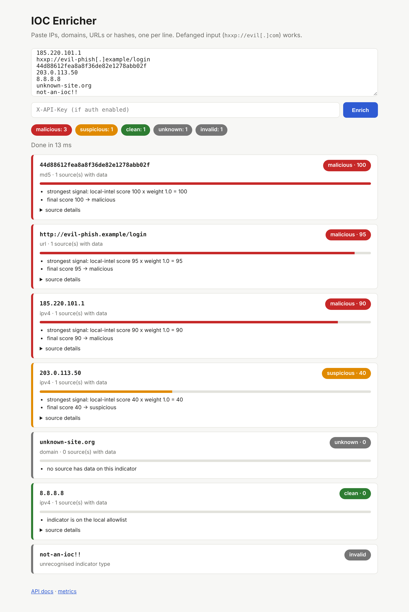
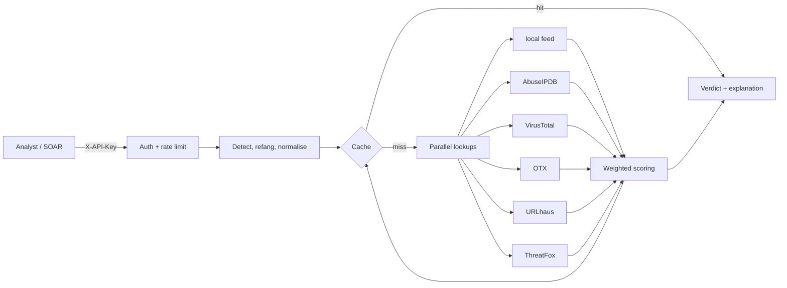
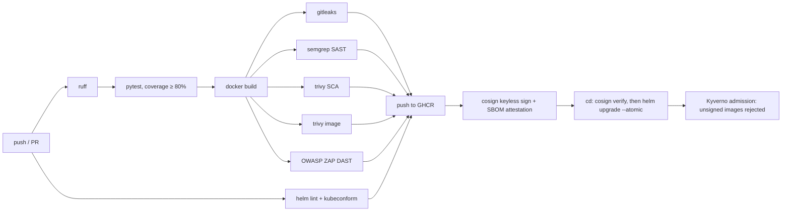

# ioc-enricher

[](https://github.com/kageninnnnn/ioc-enricher/actions/workflows/ci.yml)
[](https://github.com/kageninnnnn/ioc-enricher/actions/workflows/cd.yml)


**Threat-intel enrichment API for SOC analysts.** Send an IP, domain, URL or file hash
(defanged is fine: `hxxp://evil[.]com`) and get back one **explainable verdict** built from
six intelligence sources queried in parallel.

The service is small on purpose. The project is really about **how it is built and shipped**:
a DevSecOps pipeline with SAST, SCA, secret scanning, container scanning and DAST gates,
keyless-signed images with an SBOM, admission control in Kubernetes that only runs signed
images, and observability from day one.



---

## Features

| | |
|---|---|
| **IOC types** | IPv4, IPv6, domain, URL, MD5, SHA1, SHA256. Type auto-detection, normalisation and refanging (`[.]`, `(dot)`, `hxxp`) |
| **Sources** | Local feed/allowlist, AbuseIPDB, VirusTotal v3, AlienVault OTX, URLhaus, ThreatFox, queried concurrently with per-source timeouts |
| **Scoring** | Weighted by source reliability, with a corroboration bonus and allowlist override. Every response says *why* ([`scoring.py`](app/services/scoring.py)) |
| **Resilience** | A slow or failing provider never breaks the response: it is reported in `failed_sources`, and degraded answers are not cached |
| **API** | `POST /enrich`, `POST /enrich/batch` (dedup, partial errors, summary), OpenAPI docs at `/docs`, minimal web UI at `/` |
| **Security** | API-key auth (constant-time compare), per-key rate limiting shared via Redis, strict CSP, no secrets in logs, non-root read-only container |
| **Ops** | Redis or in-memory TTL cache, `/health` and `/ready` probes, Prometheus metrics, JSON logs with request IDs, Grafana dashboard |

## Quick start

```bash
cp .env.example .env          # optional: add API keys, every provider is optional
docker compose up --build
```

| URL | What |
|---|---|
| http://localhost:8000 | Web UI |
| http://localhost:8000/docs | Swagger / OpenAPI |
| http://localhost:3000 | Grafana dashboard (anonymous viewer) |
| http://localhost:9090 | Prometheus |

Without any keys the service still works on the bundled demo feed
([`app/data/threat_intel.json`](app/data/threat_intel.json)), so the whole demo runs offline.

### API example

```bash
curl -s localhost:8000/enrich -H 'Content-Type: application/json' \
  -d '{"indicator": "hxxp://evil-phish[.]example/login"}' | jq
```

```json
{
  "indicator": "http://evil-phish.example/login",
  "type": "url",
  "verdict": "malicious",
  "score": 95,
  "sources": [
    { "name": "local-intel", "score": 95, "weight": 1.0,
      "details": { "category": "phishing", "source": "demo-feed" } }
  ],
  "explanation": [
    "strongest signal: local-intel score 95 x weight 1.0 = 95",
    "final score 95 -> malicious"
  ],
  "failed_sources": [],
  "cached": false
}
```

Batch, for example to triage a list of IOCs pulled from a phishing email:

```bash
curl -s localhost:8000/enrich/batch -H 'Content-Type: application/json' \
  -d '{"indicators": ["185.220.101.1", "8.8.8.8", "not-an-ioc"]}' | jq .summary
# { "malicious": 1, "clean": 1, "invalid": 1 }
```

## How the verdict is computed

1. Each source returns a 0–100 score, multiplied by its reliability weight
   (local feed 1.0, VirusTotal 0.95, AbuseIPDB/URLhaus/ThreatFox 0.9, OTX 0.6).
2. The strongest weighted signal becomes the base score.
3. Every *additional* source that independently scores ≥ 50 adds +5 (corroboration), capped at 100.
4. An explicit allowlist entry wins and returns `clean`. No data at all returns `unknown`, never `clean`.
5. A score of 75 or more is `malicious`, 25 or more is `suspicious`, anything lower is `clean`.

## Architecture



See [docs/ARCHITECTURE.md](docs/ARCHITECTURE.md) for the deployment view.

## Supply-chain security pipeline



| Control | Tool | Where |
|---|---|---|
| Secret scanning (full git history) | gitleaks | [ci.yml](.github/workflows/ci.yml) |
| SAST | semgrep (`p/python`, `p/owasp-top-ten`) | ci.yml |
| SCA (dependencies) | trivy fs | ci.yml |
| Container image vulnerabilities | trivy image | ci.yml |
| DAST against the running container | OWASP ZAP API scan (OpenAPI) | ci.yml |
| IaC validation | helm lint + kubeconform | ci.yml |
| Image signing + provenance | cosign keyless (GitHub OIDC), syft SBOM attestation | ci.yml |
| Signature check before deploy | `cosign verify` | [cd.yml](.github/workflows/cd.yml) |
| Admission control | Kyverno `verifyImages` + pod security policy | [k8s/policies](k8s/policies) |
| Secrets in Git | Sealed Secrets | [k8s/sealed-secrets](k8s/sealed-secrets) |

The image that is scanned is exactly the image that ships: one build is reused as an
artifact by every gate and pushed only when all of them pass.

## Kubernetes

The Helm chart ([helm/ioc-enricher](helm/ioc-enricher)) is hardened by default: non-root
UID 10001, read-only root filesystem, all capabilities dropped, seccomp `RuntimeDefault`,
no service-account token, and a default-deny NetworkPolicy. It also ships an optional HPA,
PodDisruptionBudget and ServiceMonitor.

```bash
helm upgrade --install ioc-enricher helm/ioc-enricher -n ioc-enricher --create-namespace \
  --set existingSecret=ioc-enricher-keys
```

The full homelab setup (k3s, a self-hosted runner with namespace-scoped RBAC, sealed secrets)
is in [docs/K3S.md](docs/K3S.md).

## Observability

Prometheus metrics at `/metrics`:

- `ioc_enrich_requests_total{type,verdict}`: what is being looked up, and what it turns out to be
- `ioc_source_lookups_total{source,outcome}`: hit / miss / error / skipped per provider
- `ioc_source_latency_seconds{source}`: upstream latency
- `ioc_cache_events_total{event}`, `ioc_rate_limited_total`, `ioc_auth_failures_total`
- standard HTTP RED metrics

Logs are JSON on stdout with a `request_id` (also returned as `X-Request-ID`) and an audit
line per lookup, so they can be shipped straight into a SIEM or Loki. API keys are only
logged as a SHA-256 fingerprint.

## Configuration

All settings come from environment variables (see [.env.example](.env.example)).

| Variable | Default | |
|---|---|---|
| `ABUSEIPDB_API_KEY`, `VIRUSTOTAL_API_KEY`, `OTX_API_KEY`, `ABUSECH_AUTH_KEY` | – | Provider keys. A provider without a key is skipped |
| `API_KEYS` | – | Comma-separated client keys. Empty disables auth (dev only) |
| `REDIS_URL` | – | Shared cache and rate limits. Empty uses an in-memory store |
| `CACHE_TTL_SECONDS` | `3600` | `0` disables caching |
| `RATE_LIMIT_PER_MINUTE` | `60` | Indicators per minute per client. `0` disables the limit |
| `SOURCE_TIMEOUT` | `5` | Seconds per upstream lookup |
| `BATCH_MAX_ITEMS` | `100` | |

## Development

```bash
python -m venv .venv && . .venv/bin/activate
pip install -r requirements-dev.txt
pytest --cov=app          # all upstream APIs are mocked with respx, Redis with fakeredis
ruff check . && ruff format --check .
uvicorn app.main:app --reload
```

Adding a source means one class in [`app/services/sources/`](app/services/sources), which
implements `lookup()` and declares its supported IOC types and weight.

## Project layout

```
app/
  main.py              app factory, lifespan (shared HTTP client, cache), security headers
  security.py          API-key auth, rate limiting
  services/
    detector.py        type detection, refang, normalisation
    enricher.py        parallel fan-out, timeouts, caching, metrics
    scoring.py         explainable weighted verdict
    sources/           one module per threat-intel provider
  static/              dependency-free web UI (no inline JS, strict CSP)
helm/                  hardened Helm chart
k8s/                   Kyverno policies, sealed-secret example
deploy/                Prometheus and Grafana provisioning for docker compose
.github/workflows/     CI (security gates, sign, SBOM) and CD (verify, deploy)
```

## License

MIT
