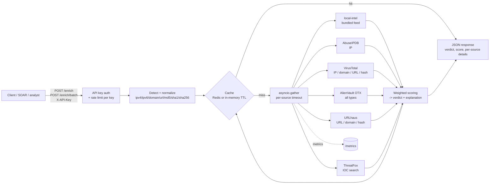
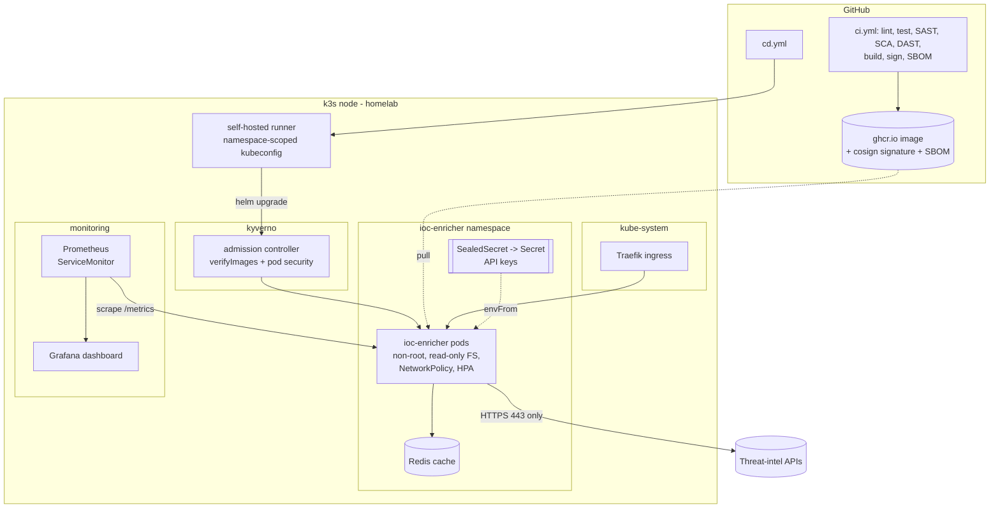

# Architecture

## Request flow

- A source without an API key, or that does not support the indicator type, is **skipped**;
  a source that times out or errors is reported as **error** and does not fail the request.
- Every lookup is counted in `ioc_source_lookups_total{source,outcome}` and timed in
  `ioc_source_latency_seconds{source}`; cache efficiency in `ioc_cache_events_total{event}`.
- Secrets (`*_API_KEY`, `API_KEYS`) are `SecretStr` in settings and never logged.

## Deployment view

Local equivalent: `docker compose up --build` starts the API, Redis, Prometheus and Grafana
with the same dashboard (`deploy/grafana/dashboards/ioc-enricher.json`).
