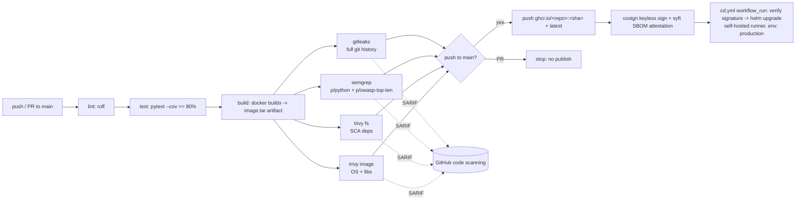

# CI/CD Security Pipeline



| Tool | Stage | What it catches | Fails build when |
|---|---|---|---|
| ruff | lint | style, bugs, unused code | any lint/format error |
| pytest + pytest-cov | test | regressions, untested code | test fails or coverage < 80% |
| gitleaks | gate | hardcoded secrets (AWS keys, tokens, private keys) in **any** commit | any finding |
| semgrep | gate (SAST) | injection, insecure deserialization, weak crypto, SSRF, OWASP Top 10 patterns | finding with severity ERROR |
| trivy fs | gate (SCA) | known CVEs in `requirements*.txt` dependencies | fixable CRITICAL/HIGH CVE |
| trivy image | gate | CVEs in base image OS packages + installed Python libs | fixable CRITICAL/HIGH CVE |
| cosign | supply chain | image tampering; CD verifies signature before deploy | CD refuses unsigned image |
| syft | supply chain | SBOM (SPDX) attested to the image for later audits | - |

Design notes:
- The image scanned by trivy is the **same tarball** that gets pushed (no rebuild between scan and publish).
- `permissions: {}` at workflow level; each job gets only what it needs (`security-events: write` for SARIF, `packages: write` + `id-token: write` only in `publish`).
- CD runs on a **self-hosted runner** because the cluster API is on a private network; the runner reaches it without exposing the API server publicly. The `production` environment can require manual approval.
- Exceptions: `.trivyignore` (with justification + review date), `.gitleaks.toml` allowlist, `.semgrepignore`.

## Demo PR (a): leaked secret blocked by gitleaks

Do not commit a real key. Build a fake AWS-format key at runtime so this doc itself never contains one:

```bash
git checkout -b demo/leaked-secret
KEY="AKIA$(LC_ALL=C tr -dc 'A-Z2-7' </dev/urandom | head -c16)"
SECRET="$(LC_ALL=C tr -dc 'A-Za-z0-9/+' </dev/urandom | head -c40)"
printf 'AWS_ACCESS_KEY_ID = "%s"\nAWS_SECRET_ACCESS_KEY = "%s"\n' "$KEY" "$SECRET" > app/demo_config.py
gitleaks git --config .gitleaks.toml --redact .   # optional local check: exits 1
git add app/demo_config.py && git commit -m "demo: hardcoded AWS creds"
git push -u origin demo/leaked-secret   # open PR to main
```

Expected: the `gitleaks` job fails with rule `aws-access-token`; `publish` is skipped; the finding appears under Security -> Code scanning.

Key lesson: deleting the file in a follow-up commit does **not** fix it - gitleaks scans full history (`fetch-depth: 0`). Clean up by closing the PR and deleting the branch (in real life: rotate the key, then rewrite history).

## Demo PR (b): vulnerable dependency / base image blocked by trivy

```bash
git checkout -b demo/vulnerable-dep
echo "requests==2.19.1" >> requirements.txt      # CVE-2018-18074 etc.
echo "PyYAML==5.3"     >> requirements.txt       # CVE-2020-14343 (CRITICAL)
trivy fs --severity CRITICAL,HIGH --ignore-unfixed --exit-code 1 .   # optional local check
git commit -am "demo: pin vulnerable deps" && git push -u origin demo/vulnerable-dep
```

Expected: `trivy-fs` fails (and `trivy-image` too, since the libs land in the image).

Variant - vulnerable base image: change both `FROM` lines in `Dockerfile` to an old tag such as `python:3.8-slim-buster` (EOL, many fixable HIGH/CRITICAL OS CVEs). Expected: `trivy-image` fails while `trivy-fs` stays green - showing why both scans are needed.

Fix path: bump to patched versions (trivy output shows "Fixed Version"), push again, gates go green. Close the demo PRs without merging.
